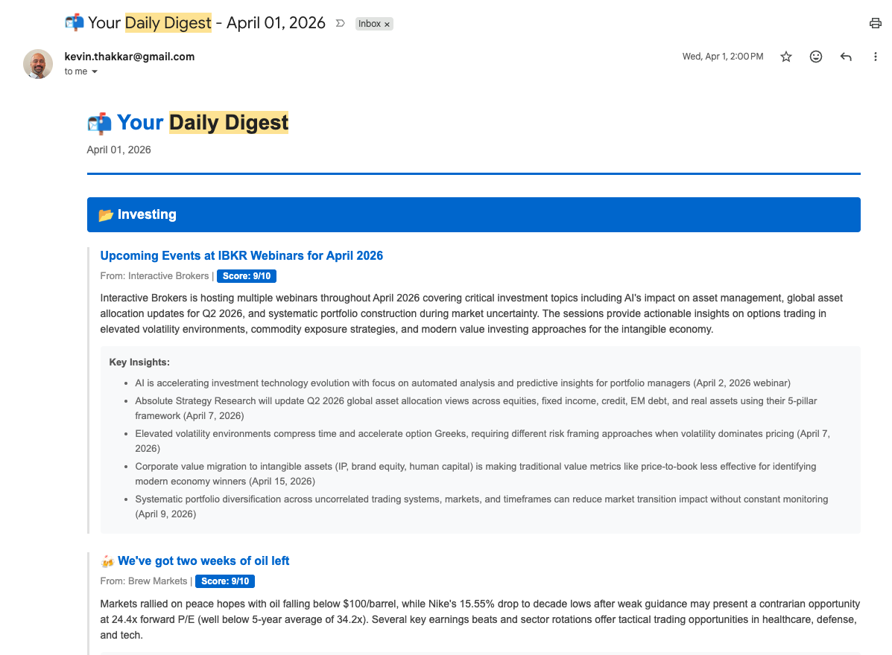
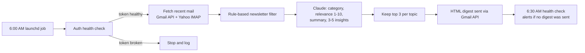

# Daily Digest

An AI agent that reads my newsletters every morning and emails me the few items worth my time.

I subscribe to more newsletters than I can read. Most mornings the useful parts were buried: a data point in a markets email, one good link in a product newsletter. Daily Digest scans my inboxes at 6 AM, uses Claude to sort each newsletter into a topic I care about, scores how relevant it is, and sends one email with the top three items per topic and the actionable takeaways from each.

## How it works

1. **Fetch.** Pulls recent mail from Gmail (API) and Yahoo (IMAP).
2. **Filter.** Cheap rules run before any model call: newsletter signals like "unsubscribe" or Substack, an allowlist of senders I always want, and exclusions for noise like LinkedIn "your post got X impressions" emails.
3. **Classify and summarize.** One Claude call per newsletter assigns one of six topics (AdTech, Fintech, Investing, Parenting, Mental Health, Product Management) or none, scores relevance from 1 to 10, and extracts a short summary plus 3 to 5 takeaways with links.
4. **Rank and send.** Keeps the three highest-scoring items per topic and sends a formatted HTML email.

## Design decisions

- **Rules before the model.** The keyword filter removes most of the inbox before any API call, which keeps cost down and stops the model from summarizing receipts and notifications.
- **One call per email.** Each newsletter is analyzed on its own, so one bad email can't derail the batch, and every output can be traced to a single input.
- **Actionable takeaways.** The prompt asks for takeaways with data points and links instead of a description of what the newsletter covers. Investing content gets its own instructions to pull out market data and trade ideas.
- **Model:** Claude Sonnet, with input truncated to 5,000 characters per email.

## Cost

One Claude API call per filtered newsletter (~2K input / ~350 output tokens). At ~15 newsletters a day on Sonnet 4, that's ~35K tokens and about $0.17 a day (~$5 a month). Cost scales linearly with newsletter count, and each additional email account adds about $3 to $5 a month. The Gmail, Yahoo and Reddit APIs are free at this volume.

## What broke and how I fixed it

| Problem | Fix |
|---|---|
| The digest silently stopped every week. Gmail OAuth refresh tokens expire after 7 days while a Google Cloud app is in Testing mode. | Added a pre-flight auth check that refreshes tokens before they expire and stops the run with a clear error if re-authentication is needed. Published the app to production mode. |
| Scheduled runs failed even though manual runs worked. macOS blocked cron from reading the project folder. | Moved scheduling to launchd and added a validation checklist for the scheduled environment. |
| Some runs crashed on a binary dependency import that only failed outside my terminal. | Pinned dependencies, ran the job from the project's virtual environment and added an import check to the validation list. |
| The digest started summarizing itself, along with LinkedIn engagement emails. | Added exclusion rules for self-referential and engagement-bait emails. |
| A failed run looked the same as a quiet news day. | Crashes now send an error email with the traceback, and a separate 6:30 AM health check alerts me if no digest was sent. Silence is treated as a failure. |

## Evals (in progress)

The digest runs every day, but I don't yet have numbers on how good it is. The plan:

1. Log every input and output for two weeks.
2. Hand-label about 100 items: right topic, would I actually read it, any claims or links not in the source.
3. Run error analysis on the labels and group the failures.
4. Turn the top failure types into checks: code checks for parse success, topic accuracy and links that appear in the source email, plus an LLM judge for whether each takeaway is faithful to the source, calibrated against my labels.
5. Fix the biggest failure and publish the before and after numbers here.

## Stack

Python · Claude API · Gmail API · Yahoo IMAP · launchd

## Next

- Wire in the Reddit source (fetcher built, not yet in the pipeline)
- Move from text parsing to structured JSON output
- Ship the eval suite above
